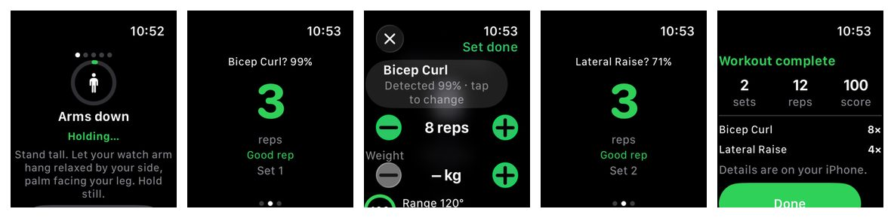
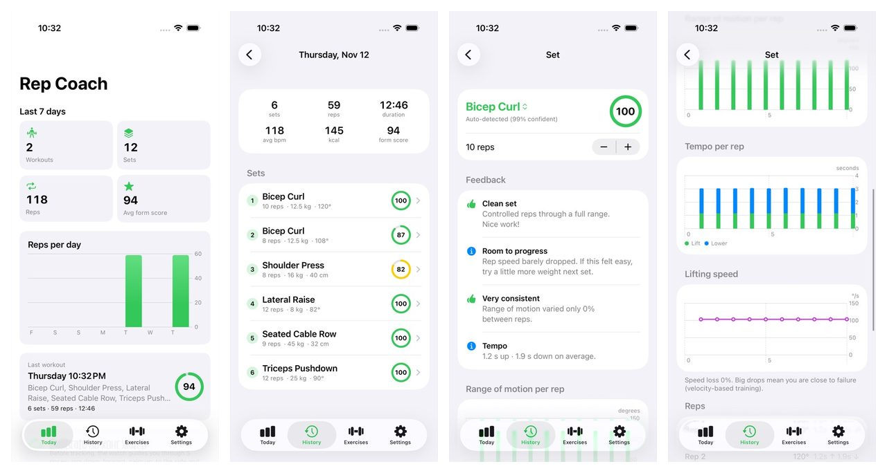

# Rep Coach – Apple Watch exercise tracker

An Apple Watch + iPhone app that uses the watch's **accelerometer and gyroscope** to

- **guide a calibration** (5 held poses, with haptic feedback at every step),
- **count reps** live (a tap on every rep),
- **guess the exercise** (free weights *and* machines) and learn from your corrections,
- **give feedback** on range of motion, tempo (lifting vs. lowering), consistency, swinging and fatigue,
- save everything to the iPhone (history, per-rep charts) and to Apple Health.

Everything runs on-device. No account, no server.





*Screenshots from the automated Simulator UI tests (the watch runs on scripted motion there).*

---

## 1. What you need

| | |
|---|---|
| Mac | Xcode **15 or newer** (Xcode 16/26 recommended) |
| iPhone | iOS **17+**, paired with the watch |
| Apple Watch | watchOS **10+** (Series 6 or newer recommended) |
| Apple ID | A free Apple ID works for testing on your own devices (apps expire after 7 days). A paid developer account removes that limit. |

## 2. Download and open in Xcode

```bash
git clone -b claude/quirky-mendel-t2w39x https://github.com/firas256/Excercise-tracker.git
```

```bash
cd Excercise-tracker
```

```bash
open ExerciseTracker.xcodeproj
```

## 3. Signing (one time)

Put your signing settings in a small private file, so updating the project never conflicts with them:

1. Copy `Config/Local.xcconfig.example` to `Config/Local.xcconfig` (same folder).
2. Replace `ABCDE12345` with your **Team ID** (10 characters). Find it in Xcode › Settings › Accounts ›
   your Apple ID › team, or by running
   `security find-certificate -c "Apple Development" -p | openssl x509 -noout -subject` (the value after `OU=`).
3. If Xcode ever says the bundle identifier is not available, also set `BUNDLE_ID_PREFIX` there
   (e.g. `com.yourname.reps`).

Add your Apple ID under Xcode › Settings › Accounts if you haven't. Then the **ExerciseTracker** and
**ExerciseTracker Watch App** targets show your team under Signing & Capabilities automatically – no need
to pick it there (picking it in Xcode edits the shared project file, which makes `git pull` complain).

> **Free Apple ID and HealthKit:** if signing fails with a HealthKit/provisioning error, remove the
> **HealthKit** capability from *both* targets (Signing & Capabilities → click the ✕ next to HealthKit).
> The app keeps working: it switches to an extended-runtime session to keep the sensors on, it just
> won't record heart rate, save to the Health app, or start the watch workout from the iPhone.

### Updating to a new version

```bash
git pull
```

If git says *"Please commit your changes or stash them before you merge"*, Xcode changed the project
file (usually because a Team was picked in Xcode). Put those edits aside and update:

```bash
git stash
```

```bash
git pull
```

## 4. Run it on your devices

1. Turn on **Developer Mode** on the iPhone (Settings › Privacy & Security) and on the watch (Settings › Privacy & Security on the watch). Restart when asked.
2. Connect the iPhone with a cable (the watch must be paired and unlocked, near the phone).
3. Pick the **ExerciseTracker** scheme and your iPhone at the top of Xcode and press **Run ▶︎**. This installs the iPhone app and the watch app.
   - To run/debug directly on the watch, pick the **ExerciseTracker Watch App** scheme and your watch.
4. The first launch of each app asks for every permission up front (Health on the watch and the phone; motion sensors need no prompt).

Tip: the iPhone app has **Settings › Add demo workout** so you can explore the history screens (also works in the Simulator).

### Try it in the Simulator (no devices needed)

The Simulator has no motion sensors, so in the Simulator the watch app automatically plays **scripted
motion** (`Shared/Processing/MotionScript.swift`): the five calibration poses, then a loop of real-looking
sets – 8 bicep curls, 10 lateral raises, 8 shoulder presses – with rests in between. It runs through the
real calibration, rep-counting, detection and feedback code, so you can watch the whole flow:

1. Pick the **ExerciseTracker Watch App** scheme and an Apple Watch simulator, press **Run ▶︎**.
2. Tap **Allow Access** (or **Not Now**), then **Start Workout**.
3. Watch calibration complete itself, then the rep counter climb, the exercise guess appear and the set summary pop up.

Optional launch arguments (Product › Scheme › Edit Scheme › Run › Arguments): `-simulationSpeed 3` plays
it 3× faster, `-simulateMotion NO` turns the script off. On a real watch the real sensors are always used.

## 5. Using it

1. Open Rep Coach on your **iPhone** and tap **Start workout on Apple Watch** (or tap **Start Workout** on the watch).
   The watch opens and starts the workout by itself.
2. **Calibrate** – follow the five poses (arm hanging down, forward palm-down, palm-up, out to the side,
   overhead). You can't read the watch with your arm up, so the steps appear **full-screen on the iPhone**
   with a stick figure and are **read aloud**; if the phone isn't nearby, the watch speaks them. For each
   pose the watch waits until you're still, holds for ~1 s, then taps your wrist ✔︎ and moves on. A
   different tap (and a spoken hint) means the pose didn't look right – adjust and hold again. Keep the
   iPhone app open on the bench in front of you. (You can turn off "calibrate every workout" in the watch settings.)
3. **Lift.** Movement starts a set automatically. The watch taps on every rep (a double tap means the rep was flagged, e.g. partial or rushed). After ~3 reps it shows its guess, e.g. *"Bicep Curl? 92%"*.
   - Swipe left to **lock an exercise** (useful for machines like the leg press where your hands don't move).
   - Swipe right for **End Set / End Workout**.
4. Rest ~5 s and the set ends. Confirm or **correct the exercise and rep count**, add the weight, read the feedback. Every confirmation teaches the classifier your form.
5. End the workout. It syncs to the iPhone (History tab: range-of-motion, tempo and speed charts per rep) and to Apple Health.

## 6. How the "AI" part works

**Is there a ready-made model?** No plug-and-play Core ML model for gym exercises from Apple Watch
motion exists publicly, but there is good public *data*. So the app ships its own model, trained on
Microsoft Research's RecoFit dataset, and you **don't need to record training data**. Two classifiers vote:

1. **Neural network (Core ML, on the watch).** A small 1-D CNN looks at 5-second windows of calibrated arm
   motion. It was trained on 94 people doing 20 exercises (curls, presses, raises, rows, squats, lunges,
   triceps work, push-ups, dips, kettlebell swings, sit-ups, burpees…) plus "not an exercise" (walking,
   cardio, stretching). On people it never saw during training it gets **88 % of exercise sets** right.
   The data was converted into the app's arm frame and augmented for left/right arm, strap position,
   grip, tempo and wrist placement – details in [`ML/README.md`](ML/README.md).
2. **Personal classifier that learns from you.** Each set is also summarised by 14 orientation-independent
   features (forearm angles, grip, rotation axis, vertical and push/pull travel, tempo…) compared with
   biomechanical prototypes of 29 exercises. Every set you confirm or correct updates these with your
   data, and the more you confirm, the more say this classifier gets.

You can also train your own model from your exported sets in Create ML and replace the shipped one.

Honest limits: some pairs move the wrist almost identically (bench press vs. shoulder press, squat vs.
goblet squat, lateral vs. front raise) – the watch will often get the family right and learn the rest from
your corrections. Exercises where the hands are fixed (leg press, leg extension/curl, pull-ups) should be
picked manually; counting is best-effort. The model's accuracy on a real Apple Watch hasn't been measured
yet – the evaluation above is on held-out RecoFit participants.

**Rep counting.** Four candidate signals are derived (gravity-based forearm angle, gyro rotation,
vertical travel, push/pull travel). The most rhythmic one (autocorrelation) is chosen and each
there-and-back cycle is counted with hysteresis. Velocity thresholds split each rep into lifting and
lowering phases, and zero-velocity updates give accurate travel distances.

**Feedback.** Partial reps (vs. your best reps in the set), incomplete top/bottom for curls, raises and
triceps work (absolute angles from calibration), rushed lifting or lowering, swinging, inconsistent range,
and speed loss across the set (a velocity-based-training fatigue indicator).

## 7. Supported exercises

| Free weights | Machines & cables | Bodyweight |
|---|---|---|
| Bicep curl, hammer curl, shoulder press, lateral raise, front raise, upright row, shrug, bench press, dumbbell fly, bent-over row, deadlift, Romanian deadlift, barbell squat, goblet squat, lunge, overhead triceps extension, skull crusher, triceps kickback, reverse fly, kettlebell swing | Lat pulldown, seated cable row, chest press machine, pec deck / cable fly, triceps pushdown, leg press*, leg extension*, leg curl* | Pull-up*, push-up*, dip*, sit-up / crunch, Russian twist, burpee, jumping jacks |

\* hands stay fixed – choose these manually on the watch; counting is best-effort.

## 8. Project layout

```
ExerciseTracker.xcodeproj   Xcode project (iPhone app embeds the Watch app)
Shared/                     Platform-independent motion core used by both apps
  Math/                     Vectors, quaternions, DSP helpers
  Model/                    Exercises, workouts, calibration profile, features
  Processing/               Calibration engine, rep detector, classifier, feedback, live tracker
WatchApp/                   watchOS app (CoreMotion, HealthKit, haptics, SwiftUI)
iOSApp/                     iPhone app (history, charts, settings, export)
Config/                     Bundle-ID prefix, entitlements, Info.plist keys
Tests/                      Unit tests for the core (simulated curls, presses, rows, …)
UITests/                    iPhone + Watch UI tests (screenshots of every screen)
ML/                         Exercise model: training pipeline, evaluation, docs
scripts/                    Project generator, icon generator
```

## 9. Tests

The motion core has no Apple-only dependencies, so its tests run anywhere Swift runs:

```bash
swift test
```

They simulate physically consistent arm motion for 13 exercises and check rep counts, tempo, range of
motion, partial-rep/rushed-rep feedback, calibration for different ways of wearing the watch, and
classification. GitHub Actions runs these tests and builds both apps on every push.

**UI tests** (`UITests/`) click through every iPhone screen and run a complete watch workout in the
Simulator (calibration → live reps → set summary → second set → end workout), attaching a screenshot of
each step. Run them with **⌘U** on the *ExerciseTracker* (iPhone simulator) or *ExerciseTracker Watch App*
(watch simulator) scheme, or on GitHub via **Actions › Simulator UI tests › Run workflow** – the
screenshots are uploaded as the `ui-screenshots` artifact.

## 10. Troubleshooting

- **"Unable to install … watch app"**: unlock the watch, keep it on the charger next to the phone, and run the *Watch App* scheme once directly.
- **Reps not counted**: make sure the set is rhythmic and the watch is snug. For fixed-hand machines, lock the exercise first (swipe left during the workout).
- **Wrong exercise**: correct it in the set summary – it learns. Reset learning in watch Settings if it ever gets confused.
- **Bundle identifier errors**: change `BUNDLE_ID_PREFIX` in `Config/Base.xcconfig`.
